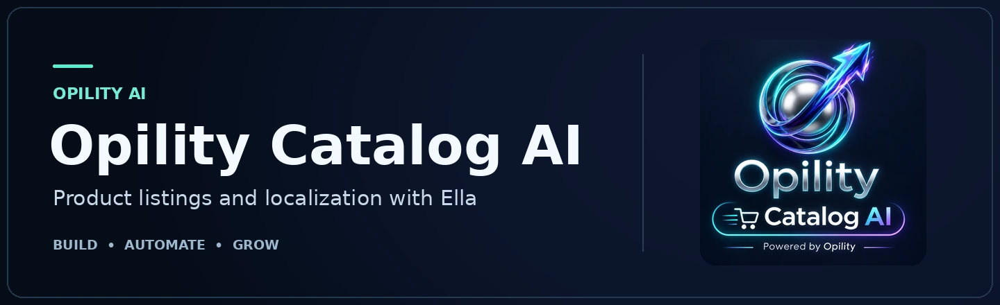
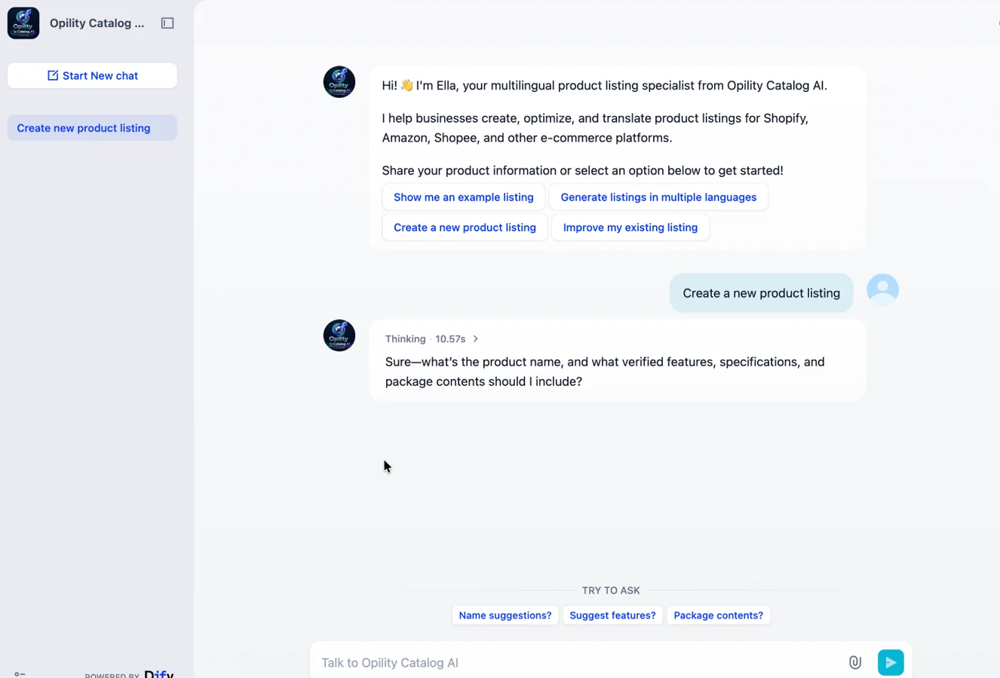

# Opility Catalog AI

**Meet Ella, Opility’s AI assistant for multilingual e-commerce listings.** Give Ella confirmed product details and get listing drafts, suggested SEO metadata, and a checklist for human review before publishing.

[Sample listing](evidence/tests/live-published-shopify-response.md) · [Build journey](evidence/case-study/docs/ACTUAL-BUILD-TIMELINE.md) · [Frontend verification](docs/WORK-MODE-VERIFICATION.md) · [Creator portfolio](https://naveensharma.net/)

## What Ella does

- **Drafts listings** with a title, selling points, and a product description based on merchant-supplied facts.
- **Localizes listings** for different markets. The published Shopify sample includes US English and Hebrew.
- **Suggests SEO metadata** and flags details to confirm before the merchant publishes.

## Ella in action

*The hosted assistant asks for verified product details before drafting.*

For the published Shopify test, Ella used a fictional DemoBrand 750 ml bottle to produce English and Hebrew drafts with SEO suggestions and review notes. [See the submitted product facts](public/proof/16_live-public-app-successful-listing-output.webp) · [Read the captured bilingual response](evidence/tests/live-published-shopify-response.md)

## Tools behind the product

| Area | Tools and purpose |
| --- | --- |
| Web experience | Next.js, React, TypeScript, and Tailwind CSS power the branded chat interface and [visual case study](app/proof/page.tsx). |
| Localization | i18next manages interface translations. |
| Agent and API | Dify hosts Ella and provides the conversation API used by the custom frontend. |
| Delivery and QA | Node.js and pnpm support the build. ESLint, TypeScript, and Python support source checks and fixture tests. |

## Build journey and verification

Opility configured Ella’s guided intake, corrected a build-mode error, applied the product branding, and captured a published bilingual listing run. [Explore the build timeline and screenshots](evidence/case-study/docs/ACTUAL-BUILD-TIMELINE.md)

| Experience | Verified evidence |
| --- | --- |
| Hosted Ella | Captured Shopify listing drafts in English and Hebrew, SEO metadata, and pre-publication review. [Read the response](evidence/tests/live-published-shopify-response.md) |
| Custom frontend | Recorded passing build, typecheck, lint with warnings, 10 integrity checks, and fixture-based HTTP smoke tests. Browser acceptance, authenticated API testing, dependency remediation, and production validation remain pending. [Read the verification report](docs/WORK-MODE-VERIFICATION.md) |

## Credits and license

Opility Catalog AI is an **Opility AI** product. Parts of the frontend are adapted from the Dify `langgenius/webapp-conversation` client. The upstream MIT copyright and license notice is preserved in [LICENSE](LICENSE). Opility branding and original screenshots retain their respective rights.
