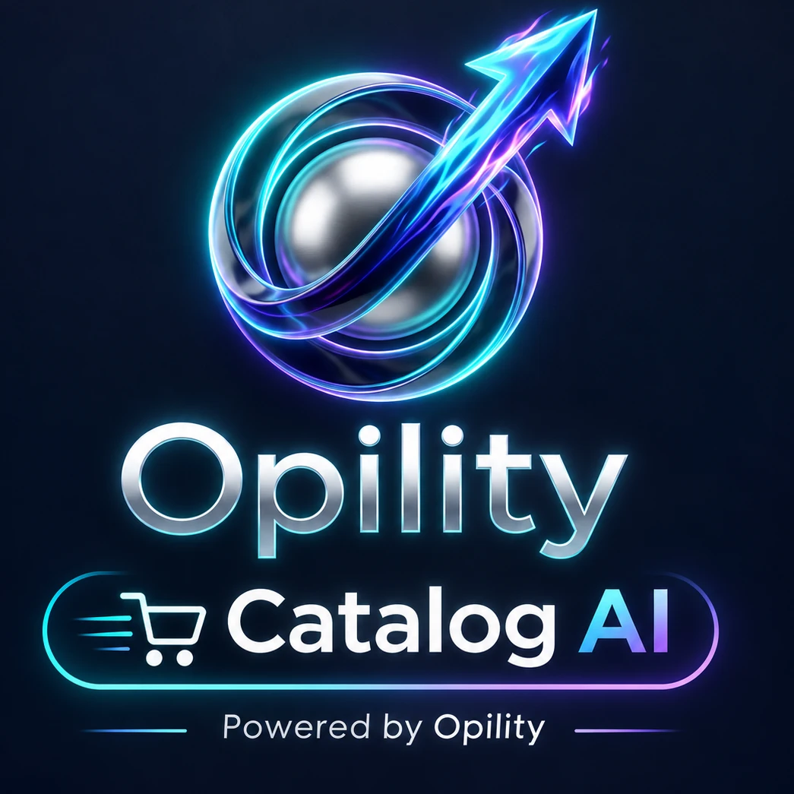
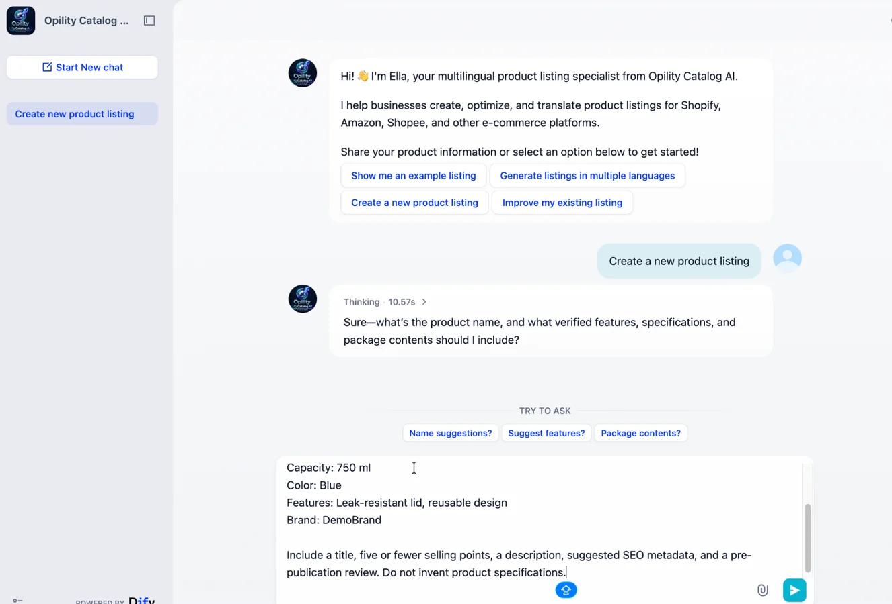

Opility Catalog AI
Create better product listings. Reach customers in their language.
Meet Ella — your AI-powered e-commerce listing and localization assistant.

Turn verified product details into clear, market-ready drafts for online stores, with multilingual copy, SEO metadata suggestions, and a built-in pre-publication review.

An Opility AI project · Build • Automate • Grow

Try Ella Live · Explore the Build & Proof · Visit Opility · Creator's Portfolio

See Ella in action
These screenshots show the hosted Ella assistant during the published listing flow. The images are cropped to focus on the app.

 
Real conversation · Ella requests product facts before drafting
  

 
Published-app test input · DemoBrand reusable bottle · US English and Hebrew requested

What Ella helps you create
- Product listing drafts — readable titles, selling points, and descriptions based on the facts you provide.
- Multilingual localization — language- and market-specific product copy, including demonstrated English and Hebrew drafts.
- SEO-ready suggestions — suggested titles, descriptions, and URL handles; not a claim of live keyword research.
- Listing improvement — revise existing product content while keeping verified information intact.
- Platform-oriented drafting — content structured for Shopify, Amazon, Shopee, and other marketplaces, with platform policy verification left to the publisher.
- Pre-publication checks — flag missing details, unsupported claims, and items a merchant should confirm before publishing.
What it does not do: It does not automatically publish products to a store or verify that a listing complies with every marketplace policy. All outputs are drafts for human review.

Built from an idea to a working agent
Opility Catalog AI began as a product-listing template and was developed into an Opility-branded assistant with a defined role, guided conversations, localization safeguards, and a testable user journey.
Stage	Work performed	Original evidence
01 · Foundation	Created the application from a Dify listing-assistant template	[App creation](./public/proof/01_create-app-from-template.webp)
02 · Identity	Established Opility Catalog AI and Ella, replacing the initial template branding	[Configuration](./public/proof/05_edit-agent-metadata.webp)
03 · Troubleshooting	Diagnosed a failed build-mode action and adjusted the configuration	[Error captured](./public/proof/08_runtime-parameter-error.webp)
04 · Publishing	Updated the public app name, description, logo, and welcome experience	[Branding settings](./public/proof/10_branding-settings-main-section.webp)
05 · Verification	Captured Ella's successful response in the editor and a live listing-generation flow	[Editor result](./public/proof/13_build-test-passes-in-dify-editor.webp) · [Published request](./public/proof/16_live-public-app-successful-listing-output.webp)

Browse the [full build timeline](./evidence/case-study/docs/ACTUAL-BUILD-TIMELINE.md) and the visual case study source. The case study is available at /proof when the frontend runs locally.
A real example: one product, two languages
In the captured live test, Ella received facts about a DemoBrand 750 ml blue stainless-steel water bottle with a leak-resistant lid and reusable design. The request asked for US English and Hebrew listing drafts, suggested SEO metadata, and a pre-publication review.
What was checked	What the captured run shows
Guided intake	Ella asked for verified product details
Listing content	Title, up to five selling points, and a short description
Localization	Separate US English and Hebrew drafts
SEO suggestions	Suggested SEO titles, descriptions, and URL handle
Claim safeguards	Missing details were flagged; the response stated no store changes were made

See the real live assistant · [**Read the captured Shopify response**](./evidence/tests/live-published-shopify-response.md)

The published-app screenshots document intake and the submitted request. The captured response text documents the resulting English and Hebrew drafts.
Verification status
- Hosted Ella. The recorded Shopify sample shows bilingual listing drafts, SEO suggestions, and a pre-publication review.
- Custom frontend. The [verification report](./docs/WORK-MODE-VERIFICATION.md) records a successful dependency install, typecheck, lint with 38 warnings, standalone production build, 10 integrity checks, and HTTP smoke tests against a local fixture.
- Pending. Browser acceptance, the authenticated Service API integration, dependency audit remediation, and production deployment validation remain open. The custom frontend is designed for private preview.
The Opility experience
This repository develops a branded web experience for the existing Ella agent, together with a visual case study and reproducible project documentation.

Project stack: Next.js · React · TypeScript · Tailwind CSS · Dify conversation API · server-side API proxy · multilingual UI foundations.

Project structure:
app/                 Next.js application and server routes
app/proof/           Visual build and testing case study
public/opility/      Opility Catalog AI identity assets
public/proof/        Cropped, real app screenshots
service/             API integration layer
config/              Application configuration
i18n/                Internationalization resources
evidence/            Build documentation and QA records
docs/                Architecture and implementation notes
tests/               Project-specific checks
Run the customized frontend locally
Prerequisites: Node.js 22+, pnpm 11, and an authorized Dify Service API key for the Ella agent.
pnpm install --frozen-lockfile
cp .env.example .env.local
# Set DIFY_API_KEY, DIFY_API_URL and DIFY_PREVIEW_PASSWORD in .env.local
pnpm dev
Open http://localhost:3000 for the frontend and http://localhost:3000/proof for the evidence page.

Security: Never commit .env.local or expose the Dify key through NEXT_PUBLIC_ variables. The development preview uses HTTP Basic authentication with username preview and the password you set; production access needs appropriate abuse controls, rate limits, privacy review, and deployment validation before inviting public traffic. See docs/ and [`WORK_MODE_HANDOFF.md`](./WORK_MODE_HANDOFF.md) for implementation notes.
Where this project belongs
On Opility: a customer-facing Opility AI product page showing what Ella does, a working demo, and real examples.

On Naveen's portfolio: an implementation case study showing configuration, troubleshooting, design decisions, tests, and the resulting working assistant.
Project credits & licensing
Opility Catalog AI is an Opility project. Ella is the assistant identity and user experience. Portions of the frontend were customized from the upstream Dify langgenius/webapp-conversation client; the upstream MIT copyright and license notices are preserved in LICENSE. Opility brand assets and original project screenshots are not automatically licensed under that third-party MIT notice.

From product facts to multilingual listings — with Ella.
Launch Opility Catalog AI · Opility — Build • Automate • Grow

